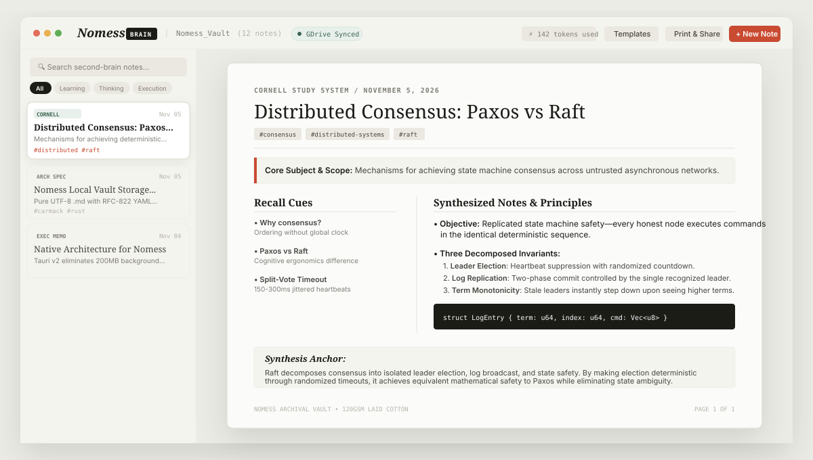
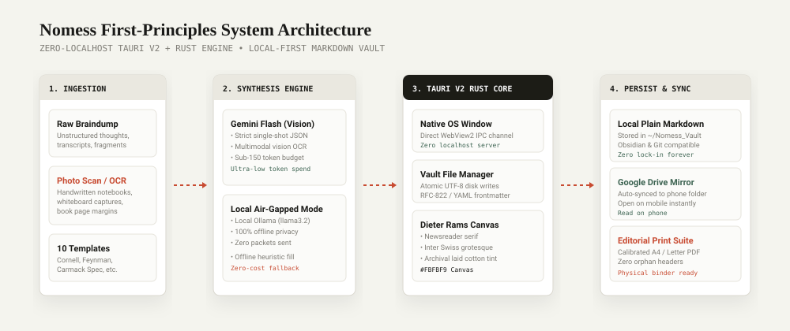
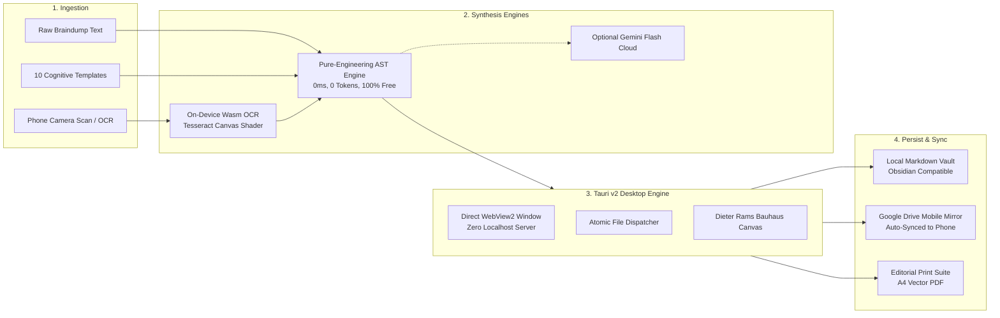

# <p align="center">📐 NOMESS</p>
<p align="center"><b>The Editorial Second-Brain Desktop Application</b></p>
<p align="center"><i>Transform messy, fragmented thoughts and scanned notebook pages into museum-grade, structured knowledge artifacts.</i></p>

<p align="center">
  
  
  
  
  
</p>

---

<p align="center">
  
</p>

---

> *"Design is not just what it looks like and feels like. Design is how it works."* — **Steve Jobs**  
> *"Never do with two chips what you can do with one."* — **Steve Wozniak**

Most people never review their captured notes because disorganized, ugly digital text repulses the human brain. **Nomess** elevates raw bullet points, hurried voice transcripts, and photos of physical notebook pages into structured, publication-grade Second Brain sheets.

Built from first principles as a **native desktop application** (Tauri v2 + Rust) utilizing direct OS WebView2 window IPC—**zero background localhost servers, zero port-binding overhead, and sub-35MB memory footprint.**

---

## 🏛️ System Architecture

<p align="center">
  
</p>



---

## 🎨 The Dieter Rams / Editorial Bauhaus Design System
- **Archival Paper Canvas**: `#FBFBF9` 120gsm laid-cotton paper texture with hairline blind debossed rules (`#E6E4DC`).
- **Typographic Discipline**: Classical optical pairing (`Newsreader` serif for editorial presence, `Inter` for Swiss grotesque legibility, `JetBrains Mono` for code and YAML headers).
- **Zero Distraction Chrome**: Everything stripped down to the bare essence of the thought artifact.

---

## 🧠 The 10 Curated Second-Brain Templates

| Template | Category | Core Mental Model |
| :--- | :--- | :--- |
| **1. Cornell Study System** | Learning | Left recall cues (30%), synthesized notes (70%), bottom synthesis anchor. |
| **2. Feynman First-Principles** | Learning | ELI5 child analogy, invariant laws, misconception breakdown, blindspot gaps. |
| **3. Executive Decisional Memo** | Strategy | Strategic context, evaluated options with trade-offs, Type 1/2 doors, 72-hr owners. |
| **4. Zettelkasten Atomic Note** | Thinking | Single conceptual thesis, interconnected `[[wiki-links]]`, reference source, tags. |
| **5. Architecture &amp; Tech Spec** | Execution | Carmack-grade system invariants, latency/memory budgets, component topology. |
| **6. Meeting &amp; Action Cluster** | Execution | Strips rambling discussion; locks in finalized agreements and RACI task owners. |
| **7. Stoic Daily Reflection** | Reflection | Marcus Aurelius format: Dichotomy of control, obstacle inversion (*Amor Fati*). |
| **8. Book &amp; Podcast Digest** | Learning | Strips 300 pages into 3 load-bearing insights, verbatim quotes, and behavioral shifts. |
| **9. Precision SOP Checklist** | Execution | Gawande-style flight checklist with non-negotiable sequence and abort triggers. |
| **10. Founder Pitch Memo** | Strategy | Peter Thiel thesis: The secret insight, burning pain, unfair advantage, flywheel. |

*(Want custom cognitive workflows? See the [Custom Templates Guide](docs/CUSTOM_TEMPLATES.md)).*

---

## 💻 Code Snippet: Local Vault Contract (Zero Lock-In)

Every note is written directly to your disk as pure UTF-8 Markdown with RFC-822 / YAML frontmatter (`~/Nomess_Vault/*.md`):

```markdown
---
id: "nm_20261105_001"
title: "Distributed Consensus: Paxos vs Raft"
template: "cornell-study"
created_at: "2026-11-05T16:00:00.000Z"
updated_at: "2026-11-05T16:00:00.000Z"
tags: ["consensus", "distributed-systems", "raft"]
tokens_used: 142
gdrive_synced: true
---

# Distributed Consensus: Paxos vs Raft

> **Core Subject & Scope:** Mechanisms for achieving state machine consensus across untrusted asynchronous networks.

### Cues & Key Questions (Recall Prompts)
- **Why consensus?**: How do nodes agree on ordering without a central clock?
- **Paxos vs Raft**: What makes Raft more cognitively ergonomic than Multi-Paxos?

### Synthesized Notes & Core Concepts
- **Consensus Objective**: Replicated state machine safety—every honest node executes commands in the identical deterministic sequence.
...
```

100% interoperable with **Obsidian**, **VS Code**, **Git**, and the **OS File Explorer**.

---

## 📱 Read on Phone via Google Drive Sync

Nomess features a built-in **Google Drive mirror directory engine**:
1. Open **Settings (`⚙️`)** in the top navigation.
2. Enter your local Google Drive folder path (e.g. `G:\My Drive\Nomess`).
3. Every note you create or edit is automatically mirrored. Open Google Drive (or any mobile markdown reader like *Obsidian Mobile* or *Taio*) on your phone to read your second brain on the go with zero paid SaaS subscriptions!

---

## 🖨️ Precision Editorial Print Suite

Calibrated for physical notebook binders:
- **A4 &amp; US Letter Margins**: 18mm standard layout.
- **Zero Orphan Headings**: Section titles never get abandoned at the bottom of a printed page.
- **True Vector Output**: Clean 300+ DPI PDF export without browser UI clutter.

---

## ⌨️ Essential Keyboard Shortcuts

- <kbd>Ctrl</kbd> + <kbd>N</kbd> — **Restructure Note** (Text braindump or photo scan)
- <kbd>Ctrl</kbd> + <kbd>P</kbd> — **Print &amp; Share** (Vector PDF / A4 sheet)
- <kbd>Ctrl</kbd> + <kbd>S</kbd> — **Save Vault** (Atomic disk write + GDrive mirror)

---

## 🚀 Getting Started

### 1-Click Launch (Windows)
Double-click:
```bat
launch.bat
```

### Or Run via Terminal:
```powershell
# Clone the repository
git clone https://github.com/shlokbuilder27/Nomess.git
cd Nomess

# Install dependencies
npm install

# Launch native desktop application (Tauri v2 + Rust)
npx tauri dev

# Or run fast web preview
npm run dev
```

---

## 📚 Documentation
- 📖 [Complete User Guide](docs/GUIDE.md)
- ❓ [Frequently Asked Questions (FAQ)](docs/FAQ.md)
- 🛠️ [Custom Template Authoring](docs/CUSTOM_TEMPLATES.md)

---

## 📬 Contact, Feedback & Feature Requests

Have a feature recommendation, bug report, or template suggestion? Reach out directly:

- ✉️ **Direct Email**: [komalmoradiya68@gmail.com](mailto:komalmoradiya68@gmail.com)
- 🐙 **GitHub Issues**: [github.com/shlokbuilder27/Nomess/issues](https://github.com/shlokbuilder27/Nomess/issues)
- 💬 **GitHub Discussions**: [github.com/shlokbuilder27/Nomess/discussions](https://github.com/shlokbuilder27/Nomess/discussions)
- 🌐 **Repository**: [github.com/shlokbuilder27/Nomess](https://github.com/shlokbuilder27/Nomess)
